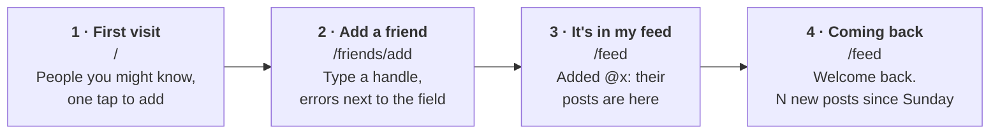
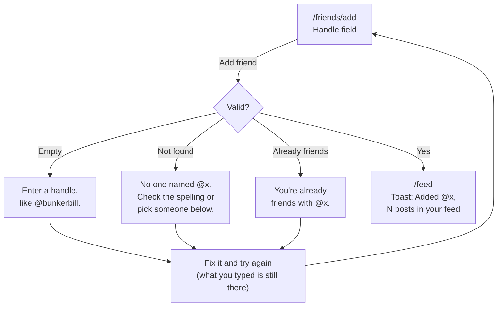
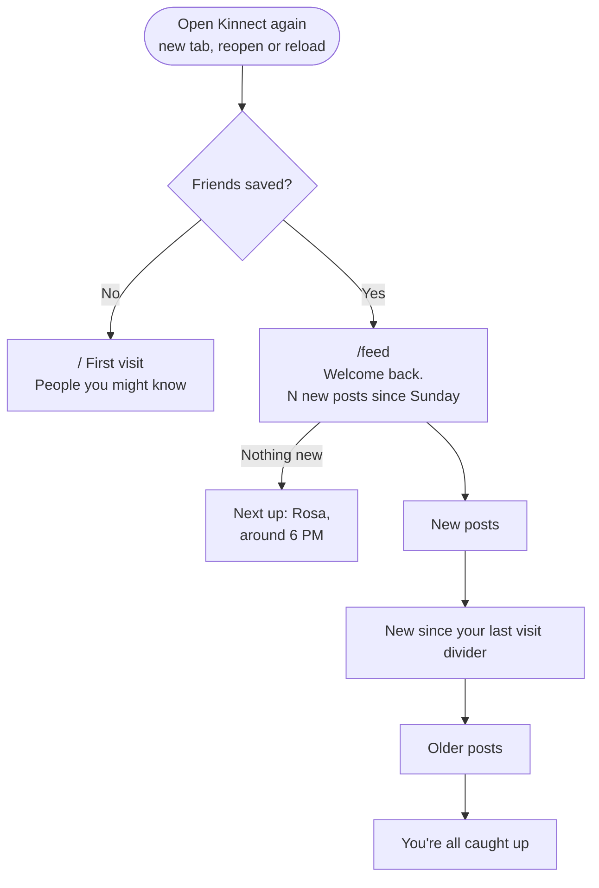

# Kinnect

**Live:** https://kinnect-chi.vercel.app

A small social app for reading what your friends are up to. You add people and read their short text posts, newest first, with no algorithm and no photos. It looks and reads like a book.

Kinnect has no accounts or database yet, so it saves to your browser (localStorage) and remembers you on the device you used. The friends are seven sample people whose posts arrive over two weeks, counted from your first visit, so there's something new when you come back.

## Testing it quickly (for graders)

1. **First visit:** open the live link in a private window or a fresh browser. You land on the welcome screen. Tap **+ Add** on a person or two, then **See your feed**.
2. **The form:** go to **Add**, press **Add friend** with the box empty, then try `@nobody`, then a handle you've already added. Each error sits under the field, and what you typed stays.
3. **Coming back:** reload the page or open it in a new tab. Every fresh open is a return visit, so the feed says **Welcome back** and what's new since then.
4. **Fast-forward:** open https://kinnect-chi.vercel.app/?fast, or turn on **Fast-forward time** under **Me**. A sample day then passes every 20 seconds, so friends post every few seconds, and the feed updates while you watch. Reload to see the welcome-back count.
5. **Start over:** **Me → Reset demo data**.

## Who it's for, and why they'd come back

I built Kinnect for someone who wants to keep up with a small circle of people without the noise of a modern feed: no recommendations, no ads, nothing ranked. Just the people you chose, in order.

What brings them back is **new posts from their friends**. The sample friends post through the day, and the app greets every return visit with what's changed:

- "Welcome back. 4 new posts from 3 friends since Saturday."
- A divider in the feed: "↑ New since your last visit".
- When nothing is new, it says who's next: "Nothing new since your last visit. Next up: Rosa, around 4 PM."

## Flows

**Main task:** I add a friend → their posts fill my feed → I come back tomorrow and see what's new since I left.

**Second task:** I write a post → it's at the top of my feed → it's still there when I come back.







All the diagrams, including the post form, the navigation map and every state, are in [flows.md](flows.md).

### Pages

| Page | Step |
|---|---|
| `/` | First visit: what Kinnect is, two live sample posts, people to add with one tap, and an **Add all** option |
| `/friends/add` | The form: add a friend by handle, with suggestions |
| `/feed` | Friends' posts and yours, newest first, with the welcome back message and a first-post prompt |
| `/post/new` | Write a post (280 characters, with a live count) |
| `/friends` | Who you've added, with Remove |
| `/me` | Your name and posts, fast-forward, and Reset demo data |

Every page shares the same navigation. On a phone the tabs sit in a bottom bar, and on wider screens they move to the top. The current page is underlined with the accent colour and marked with `aria-current`.

## Onboarding

Three subagents studied how **Bluesky, Threads and Mastodon** welcome someone new ([research.md](research.md)). Threads was fastest to something useful because it shows real posts before asking for anything. Mastodon was slowest because of the server choice and email confirmation. Bluesky's one-tap starter packs were the best way to fill a feed.

Kinnect has no sign-up at all, and I kept:

- **Posts before anything:** the welcome screen shows two live posts from the sample friends.
- **One tap to add, plus Add all**, from Bluesky starter packs and Threads.
- **A one-line bio next to every Add button**, from Mastodon.
- **Chronological only**, a lesson from complaints about Threads' algorithmic feed.
- **A first-post prompt**, which fills a gap in Bluesky.

When you add someone, their newest post appears right under their name, and a **See your feed** bar appears above the tabs. You never land on an empty screen: an empty feed suggests people, and the Friends page points to Add.

## Forms

There are two forms, adding a friend and writing a post, plus your name on **Me**. All of them use one shared `Field` component:

- one column, with a real `<label>` on every field;
- the error sits under the field, is linked with `aria-describedby`, and says what to do ("Enter a handle, like @bunkerbill.", "Cut 16 characters to post.");
- what you typed is never cleared, and focus goes back to the field.

## Components

The shared components are in `src/components/`:

- **In `ui.tsx`:** `Button`, `ButtonLink`, `TextLink`, `Field`, `Banner`, `Toast`, `PageHeader` and `Avatar`.
- **In `cards.tsx`:** `PostCard` and `PersonCard`.
- **`NavBar.tsx`:** the shared navigation.
- **`Session.tsx`:** starts the visit clock and shows the fast-forward bar.

Every page is built from these.

## Accessibility

- **Keyboard:** I checked it with only a keyboard. Tab order runs from the skip link to the tabs to the content. I added a friend, opened the feed and posted with no mouse. Every control shows a 2px focus ring.
- **Labels:** every field has a real label, every image has alt text, every button has a name, and each page has one `h1`. Toasts use a polite live region.
- **Motion:** the avatars' blink and the arrival fade stop under *reduce motion*.
- **Contrast** (checked with the agent; WCAG AA needs 4.5:1 for text and 3:1 for control borders):

| Pair | Ratio |
|---|---|
| Ink `#1f1b16` on paper `#f3eddf` | 14.7:1 |
| Muted text `#635b4f` on paper | 5.7:1 |
| Accent `#8b2e1f` on paper (and paper on accent) | 7.2:1 |
| Error text `#9e2a1b` on paper | 6.4:1 |
| Success text `#2f6b45` on paper | 5.4:1 |
| Field borders `#8f8472` on paper | 3.2:1 |

## Visual style

I started from my Assignment 2 **Swiss** design system: Inter Tight, grey paper, one red, and hard black rules. Once the first screen was built, it felt too "techie" for something you read with your morning coffee. So I moved to a **bookish** style, like reading on a Kindle Paperwhite:

- **Literata**, the typeface made for e-books;
- bone-coloured paper and soft black ink, with hairline rules;
- rounded pill buttons, sentence-case labels, and one oxblood accent like a bookmark ribbon.

The app always stays light, even in dark mode. The app also looked lifeless with initials, so each sample friend got a **cartoon avatar**. The avatars are SVGs drawn by `scripts/avatars.py`, and each one blinks every few seconds.

## Tech

- **Stack:** Next.js 16 (App Router) and Tailwind CSS 4, deployed on Vercel's Hobby plan. There are no packages beyond `create-next-app`, and no database, accounts or APIs.
- **Storage:** `src/lib/store.ts` is the only file that touches `localStorage`, under one key (`kinnect:v1`). Next week's database can replace that one file.
- **The clock:** Kinnect keeps its own clock so it can fast-forward. Each sample post in `src/data/people.ts` goes live at `first visit + dayOffset days + hour`.

```bash
npm install
npm run dev   # http://localhost:3000
```

## First-run check

_Coming next: an agent tries the live site as a brand-new user._

## How I worked with the agent

I built this step by step with Claude Code, with a commit per step (see the history):

1. **Planning (plan mode).** I picked the idea, a text-only social app. Because localStorage is per device, the agent proposed simulating the network. I chose the sample cast, the name, the retention features and the style.
2. **Flows.** The agent drew the first diagram as one tangled chart. I pushed back, and it split the chart into separate diagrams.
3. **Research.** Three subagents studied Bluesky, Threads and Mastodon. I picked which patterns to keep.
4. **Building,** one page at a time. Along the way I asked for:
   - a mobile-first layout;
   - avatars, because the app "looked too dead";
   - a bookish restyle, away from the Swiss look;
   - a welcome-back message on every return, not only after 30 minutes;
   - fast-forward, so a grader can see new posts arrive.
5. **Bugs.** I noticed the feed turning dark after visiting a missing page. The agent traced it to Next's built-in 404 styles staying mounted and fixed it.
