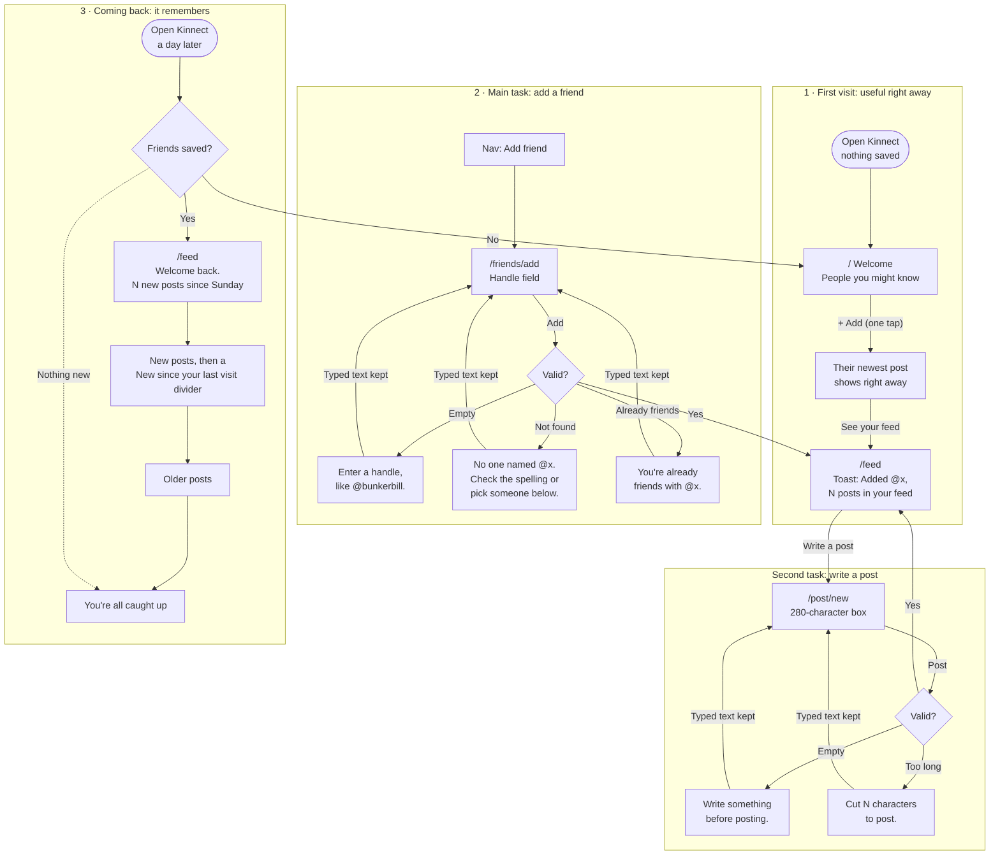
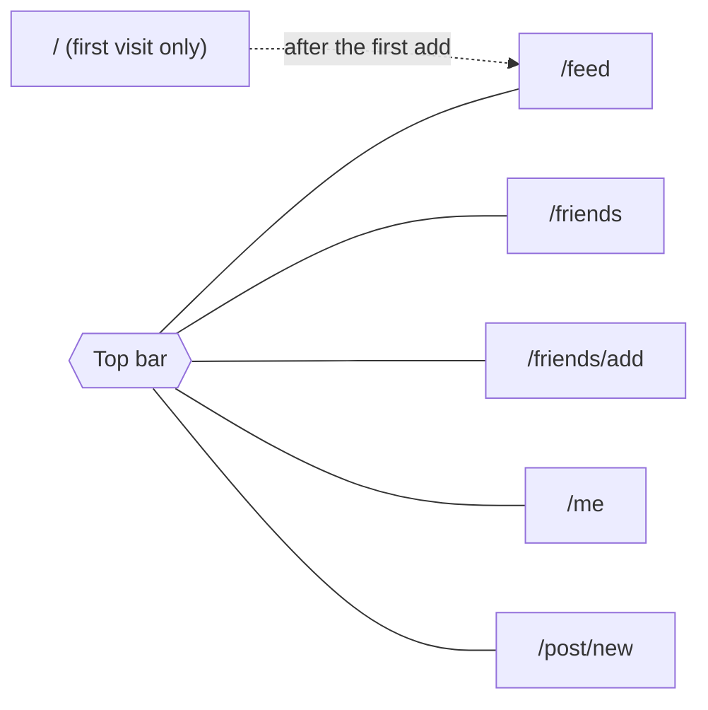

# Kinnect flows

**Main task:** I add a friend → their posts fill my feed → I come back tomorrow and see what's new since I left.

**Second task:** I write a post → it's at the top of my feed → it's still there when I come back.

## The three flows

## Pages and shared navigation

Every page shares the same top bar. The current page is marked, and every form has a Back link.

## States

| State | Where | What the person sees |
|---|---|---|
| First visit | `/` | A one-line pitch and suggested people with **+ Add**. Never an empty feed. |
| Just added | `/feed` | A toast: "Added @x: N posts in your feed." |
| New since last visit | `/feed` | A welcome-back banner with a count, and a divider after the new posts. |
| Caught up | `/feed` | "You're all caught up" at the end of the feed. |
| No friends left | `/feed` | A prompt to add someone, with suggestions (not a blank page). |
| Storage blocked | every page | A notice that changes won't be saved after this visit. The app still works. |
